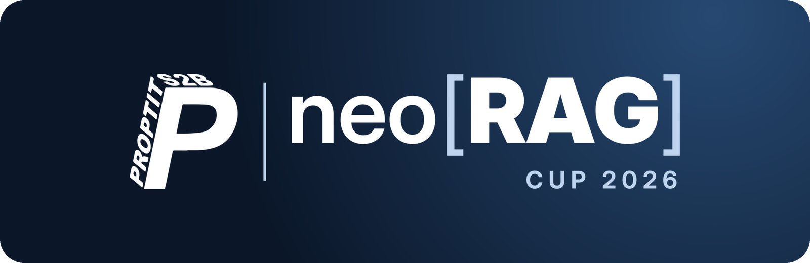
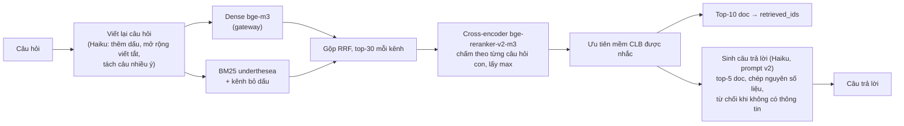

<div align="center">



<p><a href="https://www.python.org/downloads/"></a> <a href="LICENSE"></a></p>

</div>

Bài dự thi **NeoRAG Cup 2026**: hệ thống RAG trả lời câu hỏi tiếng Việt về cộng đồng S2B (CLB Lập Trình PTIT, CLB Multimedia PTIT, CLB Nhà Sáng Tạo Game PTIT). Hệ thống chỉ dựa trên 118 tài liệu của cuộc thi. Mỗi câu trả lời đều kèm nguồn, và khi tài liệu không có thông tin thì hệ thống từ chối trả lời.

**Trang giới thiệu:** https://luffyreals.github.io/NeoRAG-Cup-2026/

Repo gồm hai phần:

- **Pipeline** `neorag.pipelines.my_pipeline:MyPipeline` dùng để chấm benchmark (Public/Private Test).
- **Chatbot web** (FastAPI + SSE) dùng chung pipeline đó để demo.

## Kết quả

| | Retrieval | Generation | Score |
|---|---:|---:|---:|
| Baseline của BTC (Public Test) | | | 52.40 |
| Public Test, bài nộp cuối | 88.55 | 83.80 | 86.17 |
| **Private Test, bài nộp cuối** | **93.40** | **82.65** | **88.03** |
| Train, 126 câu, chấm đủ judge | 93.75 | 86.17 | 89.96 |

Mọi thí nghiệm, kể cả các hướng không chọn, đều có số đo và lý do trong [docs/experiments.md](docs/experiments.md). Phân tích lỗi baseline (điểm xuất phát) nằm ở [docs/error_analysis.md](docs/error_analysis.md).

## Kiến trúc



| Bước | Module | Lý do chọn (mã thí nghiệm) |
|---|---|---|
| Hybrid dense + BM25, gộp RRF | [retrieval.py](src/neorag/pipelines/retrieval.py) | BM25 bắt được tên riêng và số liệu mà dense bỏ sót (exp03) |
| Kênh BM25 bỏ dấu | [vietnamese.py](src/neorag/pipelines/vietnamese.py) | Xử lý câu gõ không dấu. Retrieval +0.048 (exp04) |
| Viết lại câu hỏi | [rewrite.py](src/neorag/pipelines/rewrite.py) | Thêm dấu, tách câu nhiều ý thành câu hỏi con. +0.030 (exp05) |
| Reranker local | [rerank.py](src/neorag/pipelines/rerank.py) | +0.064 (exp06) |
| Rerank theo câu hỏi con, lấy max | [rerank.py](src/neorag/pipelines/rerank.py) | Public có nhiều câu nhiều ý. Retrieval Public 80.1 → 88.6 (exp09) |
| Ưu tiên CLB & chủ đề/nhiệm kỳ | [clubs.py](src/neorag/pipelines/clubs.py) | Mở rộng viết tắt (`mm`, `dpt`), lọc rewrite lệch CLB, ưu tiên nhiệm kỳ/năm/giải thưởng/liên hệ và hạ doc nhiễu (`1`, `60`). Private Retrieval 85.5 → 93.4 (exp07, exp19–20) |
| Prompt v2 + hậu xử lý câu trả lời | [generation.py](src/neorag/pipelines/generation.py) | Ngắn, chép nguyên văn, không markdown; đưa mệnh đề từ chối lên đầu và cắt câu bình luận thừa giảm Noise Sensitivity (exp08, exp19–20) |
| Hiểu câu hỏi nối tiếp (chỉ chatbot) | [followup.py](src/neorag/pipelines/followup.py) | Viết lại "Ai là người sáng lập?" thành câu đầy đủ dựa trên lịch sử chat |

Mọi bước LLM đều dùng `claude-haiku-5-5` qua gateway, đúng quy định. Cấu hình nằm trong [configs/pipeline.toml](configs/pipeline.toml) (benchmark) và [configs/demo.toml](configs/demo.toml) (chatbot). Bản chatbot rerank ít ứng viên hơn và dùng int8 nên nhanh hơn khoảng 5 lần, retrieval chỉ kém 0.003 (exp12c).

## Cài đặt

Cần Python 3.10+.

```bash
python -m venv .venv
.venv\Scripts\activate              # macOS/Linux: source .venv/bin/activate
python scripts/install.py --local   # --local cài thêm PyTorch + sentence-transformers cho reranker
copy .env.example .env              # macOS/Linux: cp .env.example .env
```

Mở `.env` và điền key gateway của bạn. Lần chạy đầu sẽ tải model `BAAI/bge-reranker-v2-m3` (khoảng 2 GB) từ Hugging Face. Xem thêm ở [Hướng dẫn sử dụng](docs/guide.md).

## Chạy pipeline

CLI mặc định chạy `MyPipeline` (`--pipeline neorag.pipelines.baseline:BaselinePipeline` để chạy baseline của BTC). Các lệnh dưới đây vẫn ghi rõ `--pipeline` để log in đúng pipeline đã dùng:

```bash
neorag run train --no-judge --pipeline neorag.pipelines.my_pipeline:MyPipeline     # dự đoán + chấm nhanh (không tốn tiền judge)
neorag run train --pipeline neorag.pipelines.my_pipeline:MyPipeline                # chấm đủ, có LLM judge
neorag run public_test --pipeline neorag.pipelines.my_pipeline:MyPipeline          # tạo outputs/public_test_pred.jsonl + public_test_submission.zip
neorag run private_test --pipeline neorag.pipelines.my_pipeline:MyPipeline         # ngày 08/11
neorag validate public_test                                                         # kiểm tra file nộp
```

Báo cáo chấm nằm ở `outputs/eval_<tên>/` (`report.md`, `per_query.jsonl`). Muốn đổi cấu hình thì đặt biến `NEORAG_PIPELINE_CONFIG=path/to/file.toml`. Các cấu hình thí nghiệm nằm trong [configs/experiments/](configs/experiments/).

## Chạy chatbot

```bash
python app/server.py            # mở http://127.0.0.1:8000
```

Muốn mở từ điện thoại hoặc máy khác cùng mạng Wi-Fi thì chạy `$env:HOST="0.0.0.0"; python app/server.py` (macOS/Linux: `HOST=0.0.0.0 python app/server.py`), rồi vào `http://<IP máy chạy server>:8000`. IP xem bằng `ipconfig`, dòng IPv4 ở mục "Wi-Fi". Ai vào được trang cũng dùng key gateway của bạn, nên chỉ bật khi demo.

Đợi đến khi terminal in `Uvicorn running`, vì lúc khởi động server phải nạp model và dựng index. Tính năng chính:

- Trả lời dạng streaming. Nguồn hiện ra ngay khi truy xuất xong, trước khi model viết xong.
- Bấm vào chip nguồn để xem đoạn tài liệu đã đưa vào prompt.
- Hiểu câu hỏi nối tiếp.
- Panel hiệu năng ghi thời gian từng bước.
- Lịch sử chat lưu trong trình duyệt.
- Báo lỗi gateway, mạng, hết hạn mức bằng câu dễ hiểu, kèm nút Thử lại.

Phương án dự phòng là bản Streamlit dùng cùng pipeline:

```bash
python -m streamlit run app/chat.py
```

Kịch bản demo, số đo latency và cách xử lý sự cố có trong [docs/demo.md](docs/demo.md).

## Kiểm thử

```bash
pytest                          # dùng FakeLLM/FakeEmbedder, không gọi API
ruff check .
```

## Cấu trúc thư mục

```
app/                 chatbot: server.py (FastAPI), static/ (giao diện), chat.py (Streamlit)
configs/             pipeline.toml, demo.toml, experiments/, eval.toml (của BTC, không sửa)
src/neorag/
  pipelines/         my_pipeline.py và các module retrieval, rerank, rewrite, generation, followup
  metrics/, evaluate.py   bộ chấm chính thức của BTC
  llm.py             client gateway + cache SQLite
scripts/             install.py, compare_runs.py (so từng câu giữa 2 lần chạy), relevancy_only.py
docs/                experiments.md, error_analysis.md, demo.md, gitflow.md + tài liệu cuộc thi
tests/
```

## Tài liệu

| Tài liệu | Nội dung |
|---|---|
| [Slide báo cáo](docs/presentation.html) | Bản thuyết trình 15 slide 16:9 widescreen tương tác, hiệu ứng kinetic |
| [Bảng thí nghiệm](docs/experiments.md) | Ablation từng bước, kết quả các lần nộp Public |
| [Phân tích lỗi](docs/error_analysis.md) | Lỗi của baseline trên train, điểm xuất phát cho các cải tiến |
| [Kịch bản demo](docs/demo.md) | Chạy chatbot, checklist trước pitching, xử lý sự cố |
| [Quy trình Git](docs/gitflow.md) | Nhánh `main` / `develop` / `feature/*`, quy ước commit |
| [Hướng dẫn sử dụng](docs/guide.md), [Gateway](docs/gateway.md) | Cài đặt, key, gateway của BTC |
| [Quy định](docs/rules.md), [Đánh giá](docs/evaluation.md), [Nộp bài](docs/submission.md) | Thể lệ cuộc thi |
| [Dữ liệu](data/README.md) | Corpus và bộ câu hỏi |

## Giấy phép

Mã nguồn phát hành theo [giấy phép MIT](LICENSE). Starter kit và bộ chấm do Team AI, CLB Lập Trình PTIT cung cấp. Bộ dữ liệu chỉ dùng cho mục đích học tập trong khuôn khổ NeoRAG Cup 2026, bản quyền nội dung gốc thuộc về các CLB và các nguồn ghi trong `data/sources.csv`.
